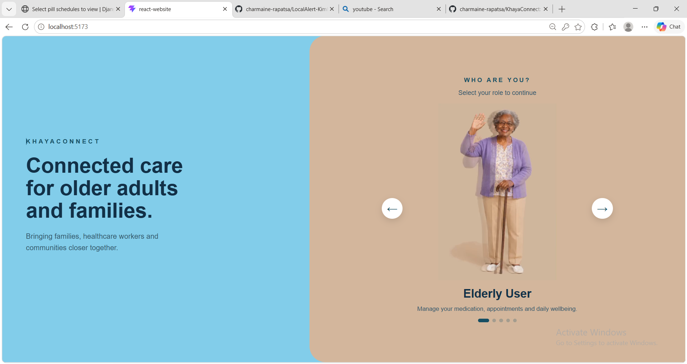
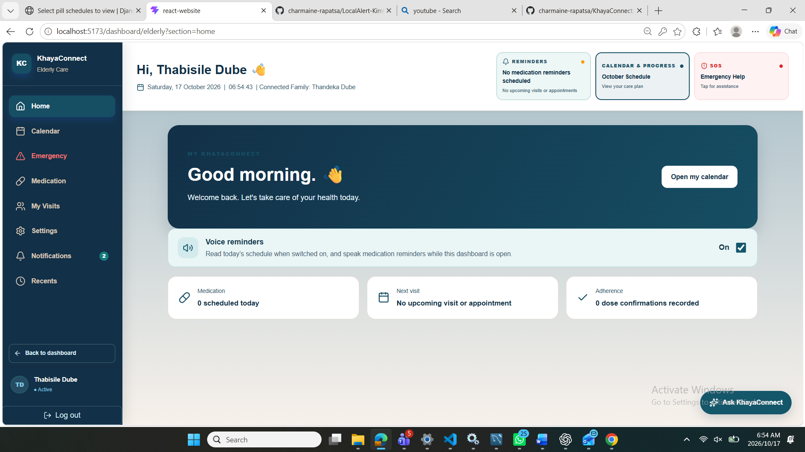
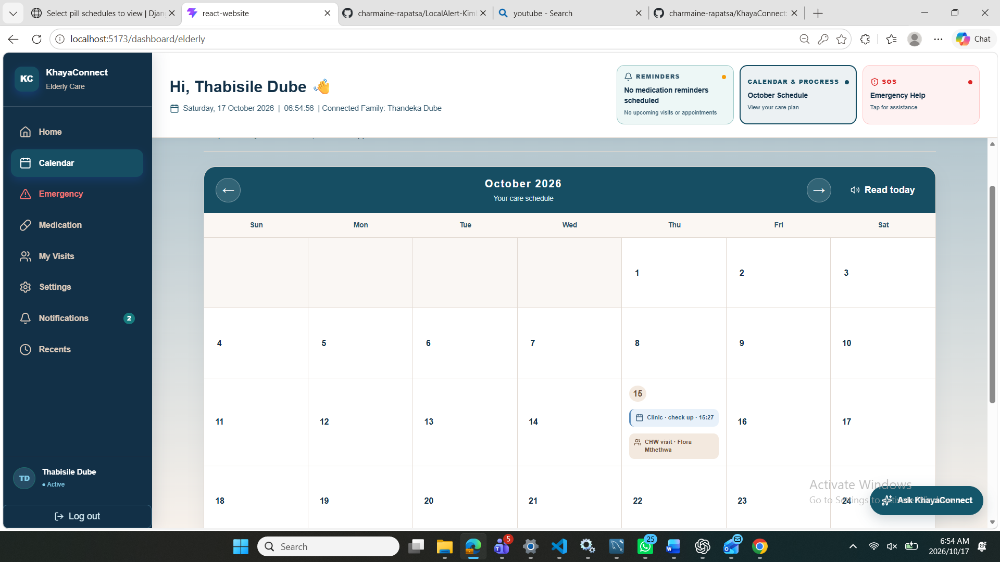
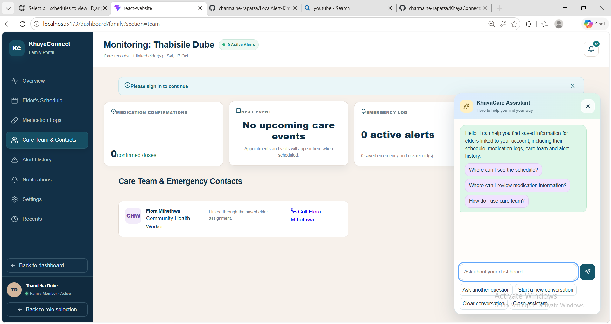

# KhayaConnect

KhayaConnect brings older adults, families, community health workers (CHWs), clinics, and administrators together to support coordinated community care. The project combines a Django REST API with a React web application.

## What it offers

- Dedicated experiences for older adults, family members, CHWs, clinic staff, and administrators.
- Tools for coordinating care assignments, visits, medication, appointments, and emergency requests.
- Shared care-team workflows, relationship management, and in-app notifications.
- A responsive web interface backed by a Django REST API.

## Screenshots

Explore the KhayaConnect experience across role selection, older adult care, and family coordination.

### Choose your care role



### Older adult dashboard



### Care calendar



### Family care team



## Technology

- **Backend:** Python, Django, Django REST Framework
- **Frontend:** React, Vite, JavaScript
- **Database:** MySQL

## Project structure

- `config/` — Django project configuration.
- `core/` — API, application models, and management commands.
- `frontend/` — React and Vite web application.
- `requirements.txt` — Python dependencies.

## Run locally

### Requirements

- Python 3.11 or newer.
- Node.js and npm.
- MySQL Server and a configured KhayaConnect database.

### Start the backend

From the repository root, create your local environment file from the example and add your local database settings and Django secret key:

```powershell
Copy-Item .env.example .env
```

Then create a Python environment and start Django:

```powershell
python -m venv venv
.\venv\Scripts\Activate.ps1
python -m pip install -r requirements.txt
python manage.py check
python manage.py runserver
```

The API is available at `http://127.0.0.1:8000`.

### Start the frontend

In a second terminal, from the repository root:

```powershell
Set-Location frontend
npm install
npm run dev
```

Open the local address shown by Vite, usually `http://localhost:5173`. The development proxy connects frontend `/api` requests to the Django server.

## Project vision

KhayaConnect is designed to make community care more connected by helping care teams share information, coordinate support, and stay in touch around the people they serve.
